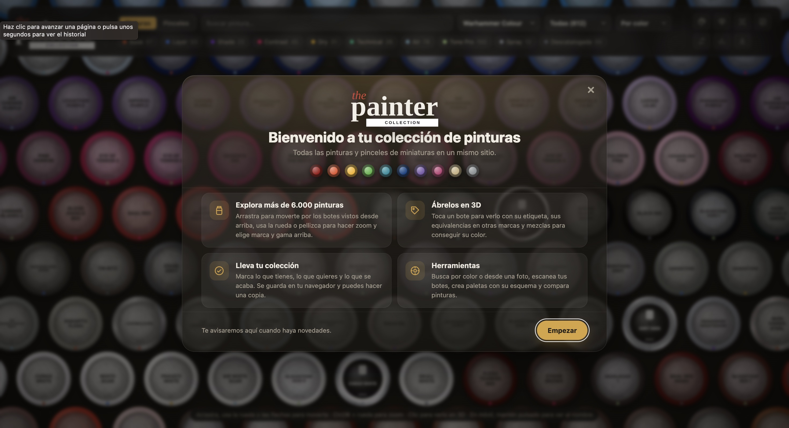

# The Painter Collection

Catálogo visual de pinturas y pinceles de miniaturas. Los botes se ven desde arriba en una cuadrícula infinita por la que te mueves en cualquier dirección; al tocar uno se abre en 3D con su etiqueta, sus equivalencias en otras marcas y mezclas para conseguir su color. También sirve para llevar el control de tu colección.



## Qué incluye

- **23 marcas y más de 6.000 pinturas:** Warhammer Colour (Citadel, con Tone Pro, sprays y la gama descatalogada), Vallejo, AK Interactive, AK Real Colors, The Army Painter, Monument Pro Acryl, Scale75, Reaper, Two Thin Coats, Green Stuff World, Kimera Kolors, Turbo Dork, P3, AMMO by Mig, Foundry, Coat d'Arms, Warcolours, Tamiya, Mr. Hobby, Humbrol, Revell, Italeri y Mission Models.
- **Pinceles de 11 marcas**, con talla, forma y tipo de pelo.
- **Botes en 3D** con el envase de cada marca: bote con tapa abatible, cuentagotas, tarro con rosca, lata y spray.
- **Tu colección:** marca lo que tienes, lo que quieres y lo que se acaba, y filtra por cada estado.
- **Equivalencias entre marcas** por diferencia de color (CIEDE2000).
- **Mezclas:** qué sale al mezclar dos pinturas y qué mezcla de las tuyas se acerca a un color.
- **Buscar por color**, también tocando un punto de una foto.
- **Escanear un bote** con la cámara: lee la etiqueta y lo marca como tuyo.
- **Paletas** por proyecto, con esquema de pintado (base, sombra, luz…), lista de la compra y enlace para compartir.
- **Comparar** dos pinturas o pinceles y **estadísticas** de la colección.
- **Copia de seguridad** en un archivo JSON y **uso sin conexión** (se puede instalar como app).

La colección y las paletas se guardan en el navegador; no hay cuentas ni servidor.

## Cómo arrancarlo

Necesita Node.js 20 o posterior.

```bash
npm install
npm run dev       # servidor de desarrollo
npm test          # pruebas (Vitest)
npm run build     # versión para publicar en dist/
npm run preview   # sirve dist/ en local
```

## Publicar

`npm run build` genera en `dist/` una web estática que funciona en cualquier hosting de archivos y en cualquier carpeta del dominio. El modo sin conexión necesita HTTPS.

Para que la vista previa al compartir el enlace salga con imagen, indica el dominio al compilar:

```bash
SITE_URL=https://tudominio.com npm run build
```

## Estructura

| Ruta | Contenido |
|---|---|
| `src/main.ts` | Arranque, cabecera, filtros y enlaces |
| `src/grid.ts` | Cuadrícula infinita y dibujo de los tapones |
| `src/pot3d.ts` | Visor 3D (Three.js), envases y etiquetas |
| `src/detail.ts` | Ficha de cada pintura o pincel |
| `src/panels/` | Herramientas: color, mezclas, escáner, paletas, comparar, estadísticas y copia |
| `src/paints.ts`, `src/brands.ts`, `src/brushes.ts` | Catálogo de Citadel, marcas y pinceles |
| `src/data/` | Pinturas del resto de marcas (generadas) |
| `src/changelog.ts` | Bienvenida y novedades que se muestran al entrar |
| `scripts/import-paints.mjs` | Regenera `src/data/` |
| `tests/` | Pruebas |

Para anunciar una actualización, añade una entrada al principio de `CHANGELOG` en `src/changelog.ts`.

## Datos

Los colores del resto de marcas proceden de [Arcturus5404/miniature-paints](https://github.com/Arcturus5404/miniature-paints) (licencia MIT). Para actualizarlos:

```bash
node scripts/import-paints.mjs
```

Los colores son aproximaciones del color en el bote y pueden diferir de la pintura real. Los datos de pinceles son una recopilación propia a partir de tiendas y reseñas; las medidas de pelo y los colores de mango son en parte estimados.

## Aviso

Proyecto personal sin relación con ninguno de los fabricantes. Los nombres de marcas y productos pertenecen a sus propietarios; las etiquetas y los logotipos de los botes son recreaciones aproximadas.
